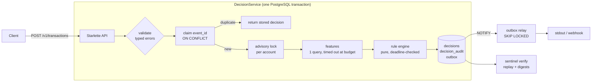

# Sentinel

**Real-time transaction decisioning.** Sentinel takes a payment event and decides APPROVE, REVIEW or
DECLINE inside a latency budget. It stores enough evidence to re-derive that exact decision later,
and its ingestion is duplicate-safe: a client can retry a request any number of times and always
gets the original decision back, never a second one.

[](https://github.com/22ishaq/sentinel/actions/workflows/ci.yml)


```
POST /v1/transactions
  │
  ├─ validate ──────── typed errors: MONEY_FLOAT_REJECTED, MONEY_PRECISION_EXCEEDED, ...
  ├─ claim event_id ── INSERT ... ON CONFLICT: a retry gets the stored decision back
  ├─ lock account ─┐
  ├─ features ─────┴── one query, capped at 80% of the budget (lock_timeout / statement_timeout)
  ├─ rules ─────────── pure, explainable, deadline checked between rules
  └─ commit ────────── event + decision + audit record + outbox message, atomically
                         │                    │                  │
                         └─ 201 + decision    └─ sentinel verify └─ relay ─▶ decision.made
```

## Results

Measured on an Apple M5 Pro (15 cores), with PostgreSQL 17.11, the service and the load generator on
the same laptop (Python 3.15). The traffic is synthetic card payments, run against the default
8-rule ruleset with a 50 ms budget. Reproduce with `scripts/loadtest.py`.

| Path | Throughput | p50 | p99 | p99.9 |
|---|---:|---:|---:|---:|
| Decision: validate, claim, lock, features, rules (1 process) | 1,150 /s | 0.43 ms | 0.50 ms | 0.68 ms |
| Same, plus persisting the audit record and committing | | 0.79 ms | 1.21 ms | 1.91 ms |
| Decision, 4 processes sharing one PostgreSQL | 3,300 /s | 0.51 ms | 0.95 ms | 1.30 ms |
| HTTP round trip, 1 uvicorn worker | 1,250 req/s | 1.48 ms | 2.14 ms | 3.92 ms |
| HTTP round trip, 4 uvicorn workers | 1,810 req/s | 2.59 ms | 6.58 ms | 8.35 ms |

**None of the 64,000 measured decisions used up the 50 ms budget.** Python threads share one interpreter
lock: extra threads add latency, not throughput. The service therefore scales by process (uvicorn
workers or replicas), and that is how it was measured.

> **Honesty note.** These numbers come from a single laptop with a local database. They show what the
> code path costs, not what a network hop to a managed PostgreSQL would add. The default ruleset's
> thresholds and block lists are illustrative, not compliance advice.

## What makes it interesting

**Money that never silently rounds**
- An ISO 4217 table of 177 codes with their minor units: 0 for JPY, 2 for GBP, 3 for KWD, 4 for CLF.
  Codes with no minor unit (XAU, XDR, XXX) are recognised, but they cannot carry an amount.
- Amounts become integer minor units through one function, `normalise()`. It rejects:
  - binary floats, with `MONEY_FLOAT_REJECTED`,
  - amounts that would need rounding, with `MONEY_PRECISION_EXCEEDED`,
  - NaN and Infinity, exponent notation, and Unicode digits (Python's `Decimal("١٢٣")` accepts
    Arabic-Indic digits),
  - out-of-range values.

  Every error carries a machine-readable code plus the offending field.
- **Hypothesis found a real bug.** The first implementation scaled amounts with `Decimal` arithmetic,
  which runs in the default 28-significant-digit context. Five of eight properties failed: a 29-digit
  amount came back rounded (`…0001` became `…0000`), and an over-precise amount was rounded into
  acceptance instead of being rejected. The fix is exact integer arithmetic on the digit string, which
  is correct at any width and refuses `1E+999999` before building a huge integer. The failing and
  fixed versions are separate commits; see [ADR 0001](docs/adr/0001-money-as-exact-integers.md).

**Duplicate-safe ingestion**
- The idempotency claim is `INSERT … ON CONFLICT (event_id) DO NOTHING`. A concurrent duplicate waits
  for the first writer to commit, then reads its decision. No locks are held in application memory,
  and there is no read-then-write race.
- Events are fingerprinted *after* normalisation, so `"12.5"` and `"12.50"` count as the same event.
  The same `event_id` with a different payload is a `409 IDEMPOTENCY_CONFLICT`, never a silent
  overwrite.
- Tested with 32 concurrent identical submissions: exactly one decision, 31 replays.

**A latency budget enforced where the time goes**
- Each decision gets a deadline on the monotonic clock. The account-lock wait and the feature query run
  under `lock_timeout` and `statement_timeout`, set per transaction to the remaining budget inside a
  savepoint. PostgreSQL cancels a slow lookup without aborting the event it has already claimed.
- The lookup gets 80% of the budget. The rest is reserved, so cheap static rules (such as a blocked
  country) always run.
- When evidence arrives late, the decision falls back to a configurable outcome (REVIEW by default).
  A degraded decision can only become more cautious: a DECLINE that already fired is never softened.
- A per-account advisory lock serialises decisions for each account. Ten concurrent £300 payments
  against a £1,000 daily limit approve exactly three.

**A reconstructable audit trail**
- Every decision stores a self-contained record with:
  - the normalised event and the feature values the rules saw,
  - the ruleset version (the SHA-256 of its canonical JSON, so the version *is* the content),
  - each rule's verdict with its evidence (`{"amount": "600.00", "limit": "500.00"}`),
  - the budget state and per-stage timings.
- `sentinel verify` re-derives each decision from its record and checks three things: the record still
  matches its digest, the stored ruleset still hashes to the version the decision cites, and
  re-running the engine reproduces the same outcome, reasons and per-rule results.
- Tests tamper with all four places evidence lives: the record, the record together with its digest,
  the decision row and the ruleset. Every edit is caught.

**Event-driven output**
- A transactional outbox: the `decision.made` message commits with the decision, so it is published
  if and only if the decision exists.
- The relay claims rows with `FOR UPDATE SKIP LOCKED`, so several relays never double-publish. It
  wakes on `LISTEN/NOTIFY` instead of polling, and it keeps order behind a failing message.
- After repeated failures, a message is parked so it cannot block the queue. Delivery is at least
  once, with a stable message id for de-duplication.

**Quality gate on every PR**
- **ruff**: lint and format.
- **mypy --strict**: over source, tests and scripts.
- **338 tests**, 104 of them against a real **PostgreSQL 17** service container, run on Python 3.12
  and 3.13. Hypothesis runs 1,000 examples per property in CI.
- **Coverage floor**: 80% branch coverage, currently 97%.
- **Docker**: the image is built and a Compose stack is smoke-tested end to end.

## Architecture



| Table | Holds |
|---|---|
| `transactions` | one row per accepted event; `UNIQUE (event_id)` is the idempotency claim; amounts are `NUMERIC(38,0)` minor units |
| `decisions` | outcome, reasons, ruleset version, budget state, latency |
| `decision_audit` | the self-contained record and its SHA-256 digest |
| `rulesets` | every ruleset ever used, keyed by content hash |
| `outbox` | `decision.made` messages, published by the relay |

## API

```bash
curl -s localhost:8000/v1/transactions -H 'Content-Type: application/json' -d '{
  "event_id": "evt_9f2c", "occurred_at": "2026-10-15T09:30:00Z",
  "account": {"id": "acc_42", "country": "GB"},
  "amount": "600.00", "currency": "GBP", "channel": "ecommerce",
  "merchant": {"id": "m_77", "category_code": "5732", "country": "FR"}
}'
```

```json
{
  "decision_id": "5d0c…", "event_id": "evt_9f2c", "account_id": "acc_42",
  "outcome": "REVIEW",
  "reasons": ["large_first_payment_to_merchant", "cross_border_ecommerce"],
  "ruleset_version": "2b7e…", "budget_exhausted": false,
  "decision_latency_us": 431, "decided_at": "2026-10-15T09:30:00.012345Z", "replayed": false
}
```

| Endpoint | |
|---|---|
| `POST /v1/transactions` | `201` new decision · `200` + `Idempotent-Replayed: true` for a retry · `409` reused `event_id` · `422` invalid event · `400` malformed JSON · `413` · `415` · `503` store unavailable |
| `GET /v1/decisions/{id}` | the decision |
| `GET /v1/decisions/{id}/audit` | the full audit record plus a live verification result |
| `GET /healthz` · `/readyz` · `/metrics` | liveness, database readiness, Prometheus metrics |

Every error has the same shape, and clients branch on `code`:

```json
{"error": {"code": "MONEY_PRECISION_EXCEEDED",
           "message": "GBP has 2 decimal places; refusing to round",
           "details": {"currency": "GBP", "minor_unit": 2, "field": "amount"}}}
```

Amounts are decimal strings in major units. JSON numbers with a fraction are rejected rather than
trusted, and so are duplicate keys in the JSON body: parsers disagree about which duplicate wins.

## Running it

```bash
docker compose up --build        # PostgreSQL, migrations, API on :8000 (2 workers), outbox relay
./scripts/smoke.sh               # decision, replay, conflict, typed error, audit verification
```

Local development (Python 3.12+):

```bash
python -m pip install -e ".[dev]"
make testdb                      # throwaway PostgreSQL on :5433 for the test suite
make check                       # ruff + mypy --strict + pytest with the coverage floor
```

| CLI | |
|---|---|
| `sentinel migrate` | apply checksummed, forward-only migrations under an advisory lock |
| `sentinel serve [--workers N]` | run the API |
| `sentinel relay [--sink stdout\|webhook]` | publish outbox messages |
| `sentinel verify [DECISION_ID]` | re-derive one decision, or all of them, from the audit trail |
| `sentinel ruleset PATH` | validate a ruleset and print its version |

Configuration is through environment variables: `SENTINEL_DATABASE_URL`, `SENTINEL_RULESET`,
`SENTINEL_DECISION_BUDGET_MS` (default 50), `SENTINEL_WORKERS`, `SENTINEL_POOL_MIN_SIZE`,
`SENTINEL_POOL_MAX_SIZE`, `SENTINEL_HOST`, `SENTINEL_PORT` and `SENTINEL_LOG_LEVEL`.

## Rules

Rulesets are JSON files, validated at startup. A bad config fails with `RULESET_INVALID` and the JSON
path of the problem, never at decision time. The [default ruleset](src/sentinel/rulesets/default.json)
uses all seven rule types:

| Type | Fires when |
|---|---|
| `merchant_country` | the merchant is in a listed country |
| `merchant_category` | the merchant category code (ISO 18245) is listed |
| `amount_above` | the amount exceeds a per-currency limit |
| `spend_velocity` | approved spend in the window, plus this amount, would exceed the limit |
| `attempt_velocity` | the account already made N attempts in the window |
| `new_merchant_amount` | a first payment to an unfamiliar merchant is large |
| `cross_border` | merchant and account countries differ on a listed channel |

## Project layout

```
src/sentinel/
  money/          ISO 4217 table, Money, normalise()
  domain.py       strict event parsing, canonical form, fingerprints
  rules/          rule types, versioned rulesets, the deadline-aware engine
  store/          pool, migrations, all SQL (repository.py)
  service.py      the pipeline: claim → lock → features → rules → persist
  audit.py        audit records and replay verification
  outbox.py       transactional outbox relay and sinks
  api.py          Starlette app, error mapping, body limits
tests/
  unit/           pure logic, including Hypothesis properties
  integration/    PostgreSQL-backed: concurrency, budgets, tampering, outbox, API, CLI
scripts/          loadtest.py, smoke.sh
docs/adr/         design decisions
```

## Design decisions

1. [Money as exact integers, and the 28-digit bug](docs/adr/0001-money-as-exact-integers.md)
2. [Idempotency through a unique claim](docs/adr/0002-idempotency-by-unique-claim.md)
3. [A latency budget enforced inside PostgreSQL](docs/adr/0003-latency-budget.md)
4. [A reconstructable, tamper-evident audit trail](docs/adr/0004-reconstructable-audit-trail.md)
5. [A transactional outbox for decision events](docs/adr/0005-transactional-outbox.md)

## Licence

MIT
